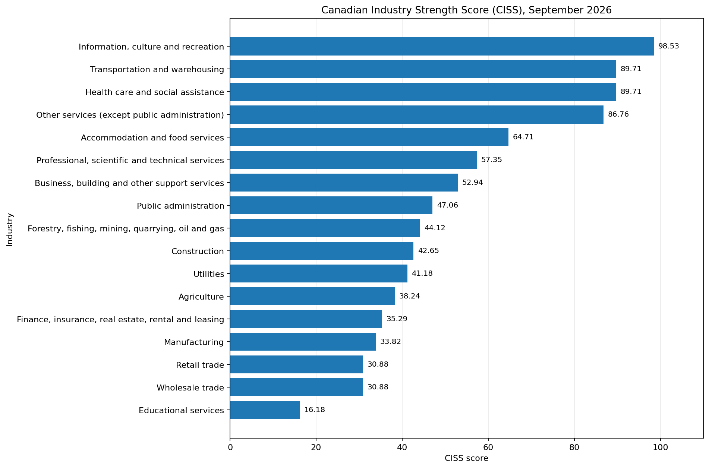
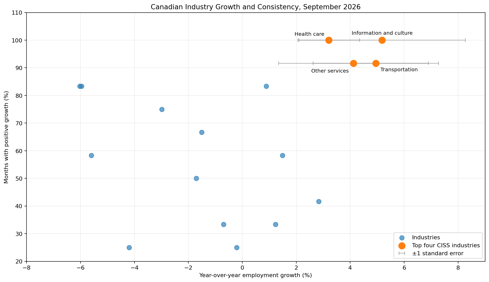
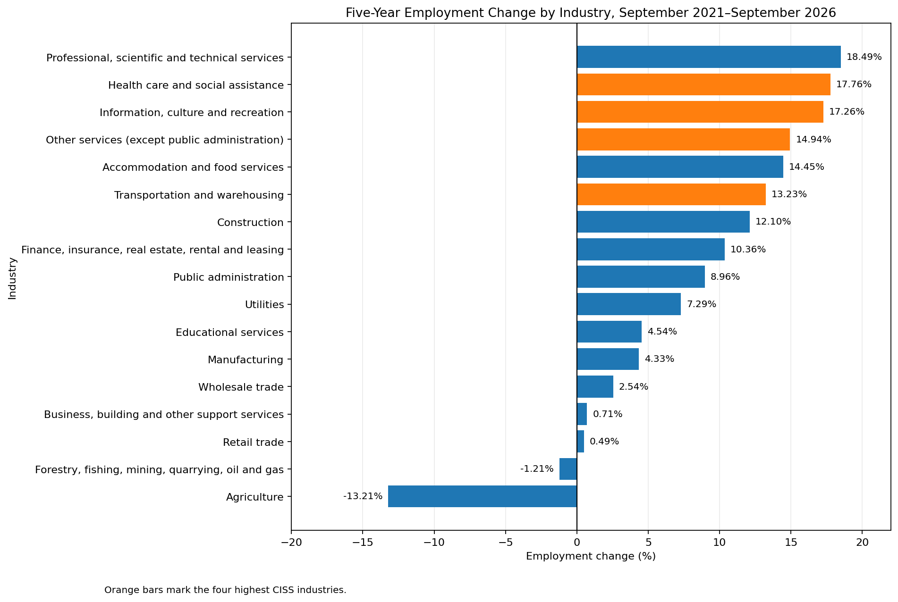

# Canadian Industry Strength Score (CISS): September 2026 Snapshot

## Research Question

Which Canadian industries show the strongest recent employment momentum, and how reliably can that ranking be distinguished from sampling noise?

## Data

**Source:** Statistics Canada, Table 14-10-0355-01, Labour Force Survey employment estimates by industry.

[Download the Statistics Canada dataset](https://www150.statcan.gc.ca/n1/tbl/csv/14100355-eng.zip)

The analysis uses Canada-level, seasonally adjusted employment estimates measured in thousands of persons. The dataset covers January 1976 to September 2026, although some industries have shorter histories. Statistics Canada's published standard errors of year-over-year employment change are also used to assess uncertainty in the latest estimates.

**Snapshot and reproducibility:** Results use data retrieved on October 23, 2026 (through September 2026). Re-running the notebook downloads the current Statistics Canada table, so values may differ after the next release or subsequent data revisions.

### Industry Selection

The original dataset contains 21 industry and aggregate series. I excluded three broad aggregates:

- Total employed, all industries
- Goods-producing sector
- Services-producing sector

I also excluded the combined Wholesale and retail trade category because it overlaps with the separate Retail trade and Wholesale trade categories. This leaves **17 industry categories** for the analysis.

## Tools Used

- Python
- pandas
- NumPy
- Matplotlib
- requests
- Jupyter Notebook

## Methodology

### 1. Latest Employment Growth

I calculated year-over-year employment growth for September 2026 by comparing employment with September 2025.

### 2. Growth Consistency

I measured the percentage of the 12 months from October 2025 through September 2026 in which an industry's year-over-year employment growth was positive.

Consecutive year-over-year growth rates overlap in their underlying monthly changes: each consecutive pair shares 11 of its 12 monthly changes. This measure is best interpreted as an indicator of persistence rather than 12 independent observations.

### 3. Canadian Industry Strength Score

The Canadian Industry Strength Score (CISS) is a custom ranking developed for this project. It is not an official Statistics Canada indicator.

Each industry receives a percentile rank for latest employment growth and another for growth consistency. **Tied values share an average rank.** The two ranks receive equal weight:

$$
\text{CISS} = 0.5 \times \text{Growth Rank} + 0.5 \times \text{Consistency Rank}
$$

Information, culture and recreation and Health care and social assistance are tied for the highest consistency percentage. Their shared average consistency rank is 97.06, which is why Information, culture and recreation scores 98.53 rather than 100.

### 4. Sensitivity Analysis

I tested three scoring methods:

- **50/50:** Equal weights for growth and consistency.
- **70/30:** More weight on latest employment growth.
- **30/70:** More weight on growth consistency.

This checks whether the leading industries depend heavily on the chosen weights.

### 5. Sampling Uncertainty

I compared the latest growth estimates with their standard errors. The percentage-point standard error is approximated by dividing Statistics Canada's published standard error of the year-over-year change by employment in September 2025 and multiplying by 100.

The growth-to-standard-error ratio gives a rough indication of how large an estimate is relative to its uncertainty. It is a screening measure, not a complete statistical significance test. The scatter plot displays **±1 standard error**, not 95% confidence intervals. Because 17 industries are screened without a multiple-comparison adjustment, about one ratio may exceed a conventional 5% threshold by chance alone, on average.

### 6. Five-Year Employment Change

I calculated the percentage change in employment between September 2021 and September 2026. This provides a longer-term comparison alongside the 12-month CISS measures.

## Results

The following table summarizes the four highest-ranked industries.

| Industry | Latest growth (%) | Approx. SE (percentage points) | Growth / SE | Positive months (%) | CISS | 5-year change (%) |
|---|---:|---:|---:|---:|---:|---:|
| Information, culture and recreation | 5.18 | 3.09 | 1.68 | 100.00 | 98.53 | 17.26 |
| Transportation and warehousing | 4.95 | 2.33 | 2.13 | 91.67 | 89.71 | 13.23 |
| Health care and social assistance | 3.21 | 1.14 | 2.80 | 100.00 | 89.71 | 17.76 |
| Other services (except public administration) | 4.12 | 2.78 | 1.48 | 91.67 | 86.76 | 14.94 |

Transportation and Health care tie at 89.71. Their order in the table is not a meaningful difference in score. The full 17-industry table is available in `canadian_industry_strength_results.csv`.

## Key Findings

### 1. The same four industries lead under every weighting scenario

Information, culture and recreation ranked first under all three weighting scenarios. The same four industries remained in the top group, although their order changed. With more weight on latest growth (70/30), Transportation and Other services moved ahead of Health care. Health care's consistency score keeps it near the top when consistency receives more weight.

### 2. Sampling error makes the ordering within the top four approximate

Using the growth estimate divided by its approximate standard error as a rough screen, Health care and social assistance was about **2.8 standard errors above zero growth**, and Transportation and warehousing was about **2.1 standard errors above zero**. These were the only two positive estimates that exceeded a rough 1.96-standard-error threshold. Information, culture and recreation was about **1.7 standard errors above zero**, and Other services was about **1.5**.

Educational services was about **2.3 standard errors below zero**, the clearest negative estimate under this approximate screen. These comparisons are indicative, not formal hypothesis tests. With 17 industries screened and no multiple-comparison adjustment, about one estimate may cross a conventional 5% threshold by chance alone, on average.

The uncertainty ranges for the top four overlap, so their precise ordering should not be treated as definitive.

### 3. Five-year results differ from the CISS ranking

Professional, scientific and technical services had the largest five-year employment increase, at **18.49%**, despite ranking sixth in CISS. Health care increased by **17.76%**, and Information, culture and recreation increased by **17.26%**.

Agriculture (**−13.21%**) and Forestry, fishing, mining, quarrying, oil and gas (**−1.21%**) were the only industries that shrank between September 2021 and September 2026.

## Visualizations

### CISS Ranking

The bar chart compares CISS scores across the 17 selected industries. Higher scores represent stronger combined recent growth and growth consistency relative to the other industries in this analysis.

### Recent Growth and Consistency

The scatter plot compares September 2026 year-over-year employment growth with the share of positive-growth months from October 2025 to September 2026. Error bars for the top four industries show **±1 standard error**, not 95% confidence intervals.

### Five-Year Employment Change

The chart compares employment changes from September 2021 to September 2026. **Orange bars mark the four highest CISS industries**; the other bars are blue.

## How to Run

Install the required packages with `pip install pandas numpy matplotlib requests`, open `canadian_industry_strength_analysis.ipynb` in Jupyter, and run the notebook from top to bottom. The notebook downloads the Statistics Canada data itself when the CSV is not already present, so a manual data download is not required. The published README and CSV use data retrieved on October 23, 2026 (through September 2026); rerunning later downloads the current table, so the results may differ after the next release or a revision.

## Limitations

- **Sampling error:** Employment figures come from a survey. Small score differences, especially in smaller industries such as Utilities and Agriculture, should not be interpreted as meaningful differences without further statistical analysis.
- **Overlapping measures:** Latest growth is one of the 12 values used in the consistency measure, and consecutive year-over-year figures share 11 of their 12 monthly changes. The two CISS components are therefore not independent.
- **Multiple comparisons:** The uncertainty comparison screens 17 industries without adjusting for multiple tests. At a 5% threshold, the expected number of false positives would be about 0.85 if all 17 null hypotheses were true; the ratios should not be read as definitive significance tests.
- **Single-month snapshot:** The ranking reflects September 2026 and the selected scoring method. The results may change as new estimates become available.
- **Five-year window:** September 2021 was still part of the pandemic recovery period. Each endpoint is a single month with its own sampling error, and the window overlaps with the period covered by CISS. It provides context rather than independent validation.
- **Scope:** CISS measures employment momentum only. It does not capture wages, job quality, vacancies, productivity, or future employment. It is not investment advice or a measure of stock-market performance.
- **Data revisions:** Seasonally adjusted series are revised over time, so results may change when Statistics Canada updates the data.

## Files

- `canadian_industry_strength_analysis.ipynb` — Notebook containing the full analysis, from data download to charts.
- `canadian_industry_strength_results.csv` — Final results for the 17 industries, including CISS scores and five-year employment changes.
- `figures/` — Chart images used in this README and project.
- `README.md` — Project overview, methodology, findings, and limitations.

## Conclusion

This project combines recent employment growth, growth consistency, and sampling-error information to compare Canadian industries. The results highlight Information, culture and recreation, Transportation and warehousing, Health care and social assistance, and Other services as the strongest four-industry group under the selected CISS method.

The sensitivity analysis shows that this group remains stable when the weights change, while the uncertainty analysis cautions against treating small differences in score or rank as definitive. Comparing CISS with five-year employment changes also illustrates how recent momentum can differ from longer-term employment performance.

Through this project, I practised data cleaning, time-series calculations, percentile ranking, sensitivity analysis, sampling-error interpretation, data visualization, and exporting results with Python.
